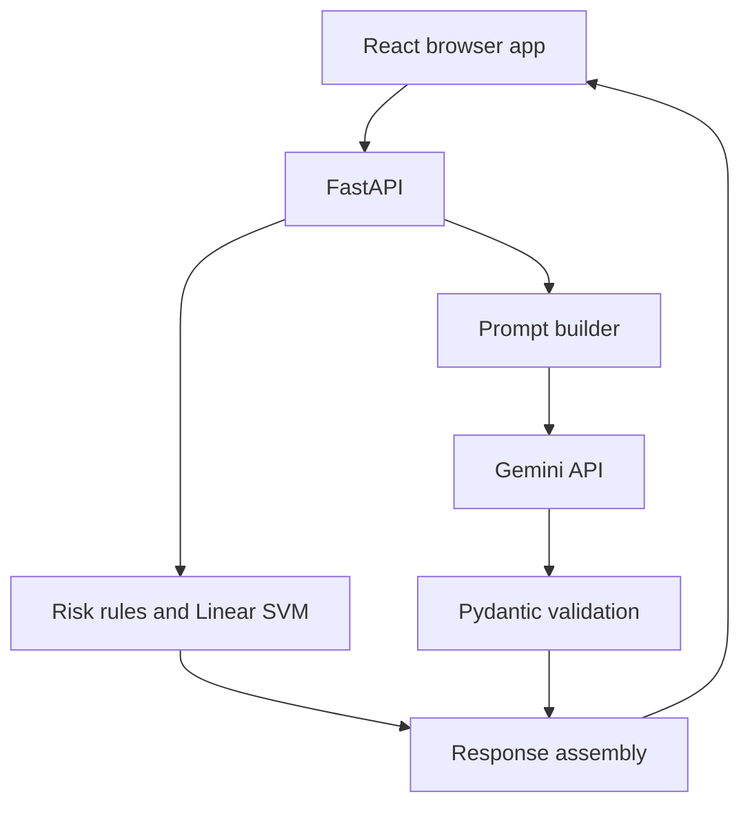
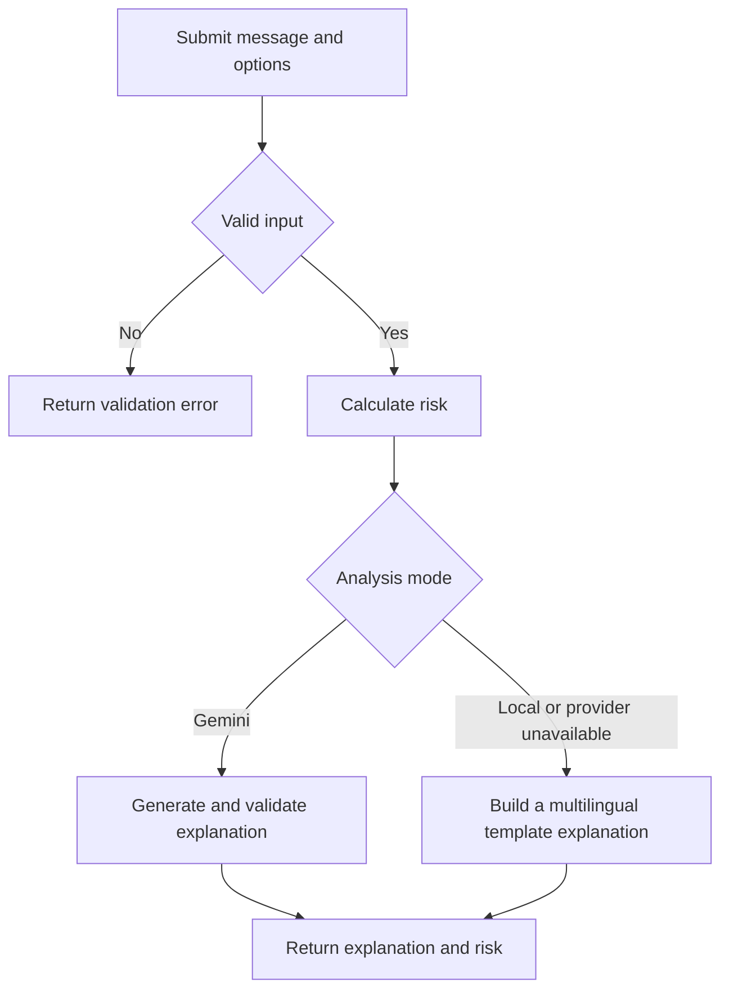
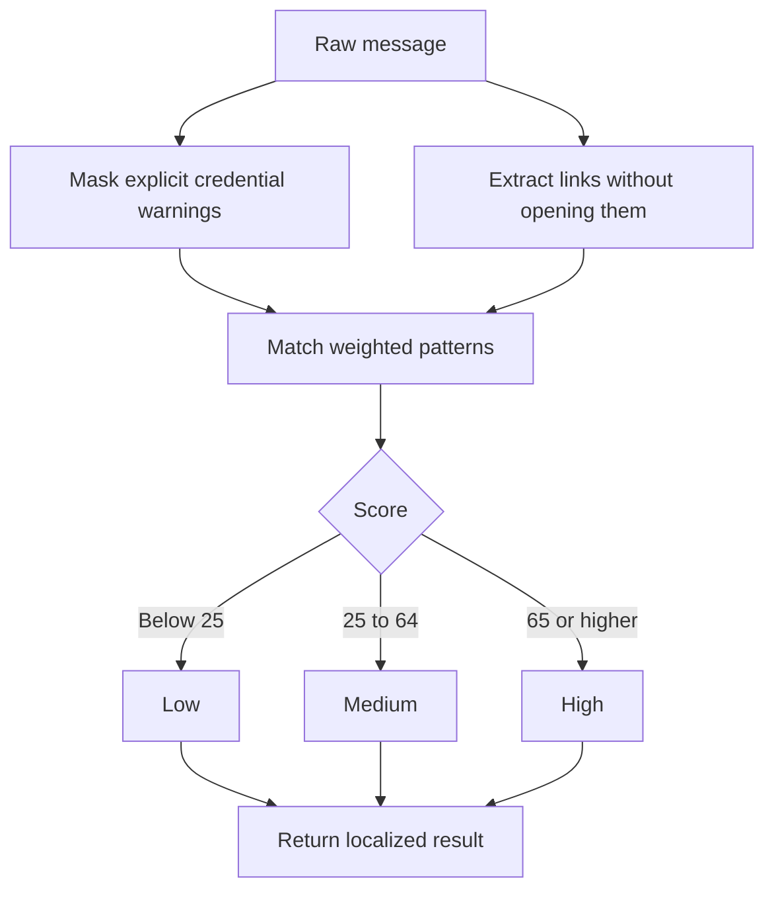

# Architecture

The browser calls a FastAPI service over JSON. Gemini is invoked server-side and only the backend loads the API key. No app database, local storage or message logging is used. Successful and error responses set `Cache-Control: no-store`. Restrict the allowed origins to your frontend. If deploying outside localhost, configure HTTPS, authentication or a gateway quota to control access and cost.

## System architecture

## Message analysis

At the backend research comparison endpoint the API computes risk once and requests three explanations concurrently. It reports per-version errors if any versions succeed. Provider timeouts, rate limits and malformed output produce structured errors.

## Risk pipeline

Each rule contributes at most once. The running analyzer also invokes the fitted char-TF-IDF Linear SVM. The final tier is the higher of the two component tiers. Scores are capped at 100. The URL rule treats links as unverified. It checks known shortening domains and recognizes one synthetic fixture domain. It never opens or authenticates a link.
