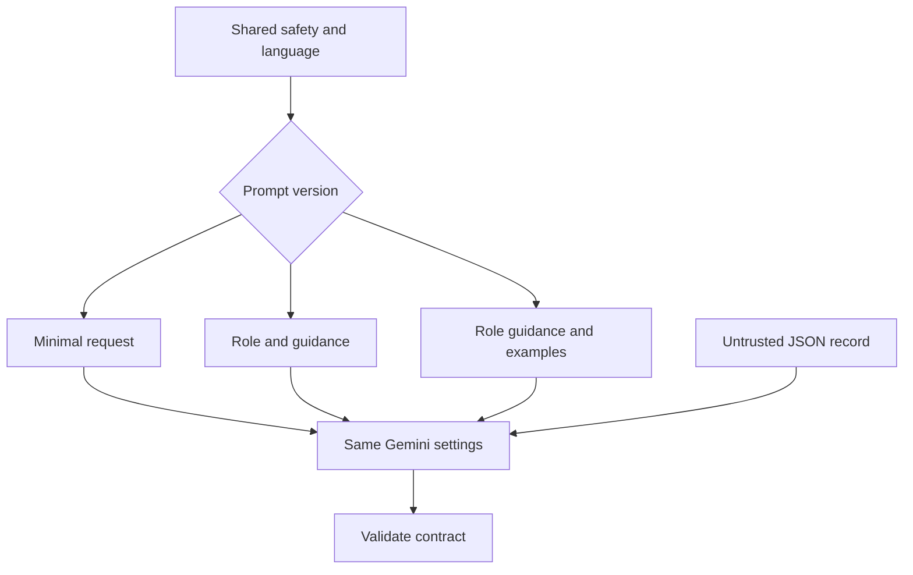

# Prompt engineering

| Version | Intervention | Example count |
|---|---|---|
| P0 | Minimal instruction to explain the message and suggest next steps | 0 |
| P1 | Financial literacy role, factual detail, safety and analogy guidance | 0 |
| P2 | P1 role and instructions plus structured output guidance and multilingual demonstrations | 6 |

P1 tests the combined effect of a role and added instructions. P2 tests the combined effect of demonstrations and an explicit JSON instruction. Neither comparison isolates individual changes. The same model, temperature, token budget, common language instruction, safety instructions and provider-level schema apply to every version. The client validates a second time with Pydantic. The application keeps risk independent so the model cannot change it.

The six demonstrations cover debit, credit, OTP phishing, KYC phishing, EMI and reward claims. They use invented data and are distinct from the holdout. The sample safety fixtures and dataset wording can still share patterns.

The message travels as a JSON data record, separate from the system instruction. Gemini receives no tools. Outputs are rendered as escaped plain text and detected URLs cause a handled error. These measures do not establish live prompt injection success rates.

[Google Gemini structured output reference](https://ai.google.dev/gemini-api/docs/structured-output)
